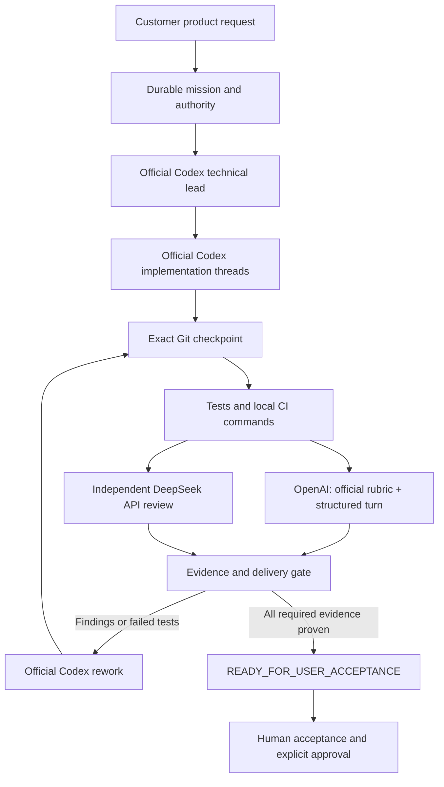

# Software delivery factory architecture

The completed architecture audit is an input, not reopened here: this is an independent Python governance harness, not an OpenAI Codex fork. Reviewer V2 had medium/high execution duplication. New missions use a factory loop, not another review framework.

There is no merge/release executor after L. The customer does not schedule agents or repair ordinary engineering failures.

## Components and responsibilities

| Responsibility | Implementation |
|---|---|
| Product goal | Immutable v2 mission: repo/base/objective/acceptance/constraints/scope |
| Technical lead | Official Codex turn with bounded plan, tasks and genuine product decisions |
| Development agents | Fresh official Codex thread per task, sequentially editing an isolated candidate |
| Rework | Official Codex debugging turn with test/CI failures and findings, bounded rounds |
| Tests / CI | Existing project commands through reused bubblewrap isolation; verified exit codes |
| OpenAI review intelligence | Unmodified upstream rubric + App Server `outputSchema` |
| Independent second opinion | Direct DeepSeek HTTPS API, separate credentials/context, no prior lane conclusions |
| Evidence / budget / recovery | SQLite reservations, immutable completed accounting, append-only audit, hashed raw files |
| Delivery / authority | Reconcile target and gates; exact-HEAD human approval; no merge/release executor |

`factory.py` contains mission governance, `factory_runtime.py` thin invocations, `factory_cli.py` the customer interface, and `factory_fixture.py` cost-free acceptance. Existing `codex.py` protocol/security helpers and `sandbox.py` are reused. No workflow DSL, plugin platform, generic review framework or custom subagent runtime was added.

Private factory state is separate from historical `data/harness.sqlite` and formal ledgers. Candidate Git databases are independent clones without origin remotes, object hardlinks or alternates. Source refs/history remain untouched. Each review lane gets its own exact-head repository copy.

## Why an official-rubric structured turn

Official App Server supports `review/start` and `turn/start.outputSchema`. The installed Codex 0.159.2 schemas were generated and inspected. `review/start` exposes rendered `exitedReviewMode.review`; upstream review parsing can fall back from unparseable JSON to explanation with default findings. Treating rendered prose as an empty PASS would weaken this harness.

The replacement therefore uses the exact official rubric as `baseInstructions`, the official repository/tools/model runtime, and the official finding schema through `outputSchema`. Harness validates the result without reproducing review reasoning, priority classification or synthesis. The upstream rubric, Apache license, NOTICE and commit/hash provenance are vendored; the rubric is integrity-checked. This is genuine source reuse without claiming to be a Codex fork.

Official sources: [App Server](https://developers.openai.com/codex/app-server/), [permissions](https://developers.openai.com/codex/permissions/), [configuration](https://developers.openai.com/codex/config-reference/). Exact upstream provenance: `src/harness/vendor/codex/provenance.json`.

## Exact scope and independent evidence

Target identity includes canonical repository, immutable base, head/commit, tree, customer file scope, complete changed paths and full binary Git diff hash. The base must be an ancestor. Dirty/untracked source cannot be tested, reviewed or delivered. Optional committed project scope authority must retain its original blob.

Tests, CI and both reviews bind to that target. Official-format finding paths must be canonical and inside the lane repository, committed line ranges must exist, and locations must overlap the exact diff. Removed-file references bind to the base blob and also identify the delivery head. Missing, malformed or contradictory results never PASS. All actionable findings trigger rework without an adjudication ladder.

OpenAI review has a fresh official thread without implementation history. DeepSeek receives product requirements, full diff and bounded tracked text context, never OpenAI's results. Same-provider agents cannot satisfy independence. Oversize inputs stop; partial/chunked payloads cannot claim complete coverage. Changed submodules cannot be certified from gitlink hashes alone.

## Profiles and accounting

Model/profile identity is lane-local. OpenAI uses official selected configuration unless explicitly selected; runtime model/provider identity, config hashes, version and raw events are preserved. DeepSeek uses its official HTTPS endpoint and must return the configured model and a non-truncated completion. Changing one review profile creates evidence only for that lane; the other provider's receipt and all accounting remain immutable. Same-target review refresh does not authorize rewriting delivered source. Changing the code head correctly requires both providers to review the new target.

Operator authority fixes run budget, timeout, rework rounds, commands, capacity and independence at mission creation. It cannot increase on resume. SQLite transactionally reserves before dispatch. Failure/UNKNOWN consumes its run reservation. Completed accounting cannot be edited, deleted or refunded. Historical UNKNOWN is never backfilled from later requests.

Budget units are agent executions, not dollars or internal Codex model requests. Native subagent fan-out is disabled to avoid an unregistered execution tree; role/task threads still use the official runtime. Real money remains UNKNOWN; Provider account limits are necessary for a monetary ceiling. Fixture telemetry explicitly records zero real Provider calls and cannot become a formal receipt.

Known completed results are reused after envelope and raw-file hash verification. A proven completed malformed review allows one separately charged validation attempt. Lost requests never automatically replay. Controller death with a reservation but no trustworthy completion is UNKNOWN. A published implementation receipt can recover its pending Git checkpoint without repeating that paid execution. A per-mission POSIX lock prevents concurrent controllers from racing source/dispatch. GNU `timeout` also bounds the App Server process independently of controller reads; controller death cannot leave an unlimited paid runtime.

## Safety and delivery

Constructor-bound official permissions allow developer source edits and keep Git metadata read-only. Planner/reviewer have a minimal repository/runtime read profile. Original source, controller/evidence storage and authentication are unavailable to delegated tools. Network is disabled; approval requests are denied. Existing trusted launcher/PATH and environment allowlists are reused.

From the Owner's 2026-11-01 boundary decision, writable delegated sessions use only their exact candidate and a Controller-allocated private temporary workspace. Both roles use the minimal repository/runtime profile; neither inherits the built-in `:workspace` host-temp grants. Developer scratch is bound to the canonical worktree and fresh permission profile, outside the candidate and protected roots, and verified before reuse and cleanup. Shared host `/tmp`, other sessions' scratch and candidate-selected paths are not delegated. Read-only roles receive no writable scratch. See [the temporary workspace contract](DELEGATED_TEMPORARY_WORKSPACE.md) for lifecycle, failure and recovery limits. This new rule does not reclassify historical reviews or authorization.

### Native delegation and usage compatibility

Codex 0.164.0 still recognizes the legacy `features.multi_agent` and
`features.multi_agent_v2` fields, but its native collaboration instructions
remain present with those fields false. The adapter also sets the documented
`agents.enabled=false` at process startup and in the thread configuration.
Offline native configuration checks and prompt rendering verify those inputs;
they do not prove that a real Provider turn will finish successfully.

Each adapter invocation binds one fresh thread and its accepted turn before
using token telemetry. Notifications retain their thread/turn attribution;
foreign activity or native delegation stops execution as UNKNOWN. If a usage
notification precedes the turn/start response, it is retained and matched to
the accepted turn before affecting the cutoff. Unexpected delegation can
already have incurred work when its notification arrives, so this guard is
not a physical spending guarantee.

`usage_telemetry` preserves per-thread/per-turn cumulative snapshots in the
existing operation evidence, including on failure. A snapshot's `total` is
not a turn delta; `last` is not added to `total`, and cached input is already
included in input. Parent/child snapshots are never summed as a bill. Failed
execution still retains the original full reservation alongside attributable
partial usage. No historical accounting is rewritten or settled by this fix.

An independent patch review may instead use a manual Controller with the
official App Server `thread/start` and `turn/start.outputSchema` interfaces,
the pinned rubric, the existing direct DeepSeek worker and exact-source
validator. It need not invoke `Factory` or this adapter. Such evidence must
identify its actual path; it is not a Factory delivery receipt, and does not
demonstrate autonomous Factory orchestration. Native telemetry and rollout
budgets cannot establish a physical cost hard cap.

Configured MCP/plugins are explicitly disabled: empty TOML tables merge and do not clear inherited servers. Hooks/apps are disabled. The cwd is the verified Git root, so parent project-root probing is disabled while repository instructions remain available. Tests reuse bubblewrap: clean env, no network, read-only source/Git metadata, sanitized Git config, private logs. Missing isolation fails closed.

Only proven local tests, configured CI commands, required reviews and final target/evidence reconciliation produce READY. Read-only status also rejects stale HEAD or changed evidence. Major product decisions, budget exhaustion, capacity and uncertainty produce explicit blockers. Human approval records exact target and reason; no automatic final merge/release code exists in the factory. Fixtures cannot receive live approval.

## Deprecated execution and safe replacements

| Retired responsibility | Safety-preserving replacement |
|---|---|
| Byte-chunk DAG; fixed 21/7/group=3 | Full diff and source exploration; explicit capacity failure |
| Groups and multi-level synthesis | One full-target official-format result per lane with raw evidence |
| Generic custom reviewer prompts | Unmodified pinned official rubric and transport schema |
| Custom severity/finding intelligence | Official priority/correctness, only evidence/shape validation locally |
| Mandatory disposition/adjudication | Direct bounded rework, retest and full rereview |
| Generic subagent lifecycle | Official thread/turn lifecycle with small mission task dispatch |
| Group-dependent source identity | Git paths, committed blobs, lines and exact target |
| Global qualification invalidation | Lane-local profile keys; unrelated provider evidence preserved |
| Hardcoded OpenAI model pins | Official configuration and recorded actual runtime identity |
| Identity-exception machinery | No chunk/group/synthesis identities in the new pipeline |

Legacy scripts/modules remain explicitly deprecated compatibility and regression-test subjects. Their historical receipts/UNKNOWN are not reinterpreted. New factory execution does not depend on old reviewer scheduling, manifests, group blockers, synthesis or qualification publication. Old CLI execution needs `--legacy`; live legacy auto-merge is rejected. The existing group blocker remains history, not a new delivery dependency.

Active runtime complexity is lower. Repository size temporarily increases because historical compatibility code is intentionally retained; retirement does not require erasing old source/evidence.

## Pilot limits

This is a local Linux factory, not a hosted service. It does not automatically publish PRs, push, poll hosted CI or deploy. Local configured CI PASS is not a GitHub status claim. Authentication/model access and project dependencies must exist. Read-only gates need build outputs in configured temporary locations. Oversize DeepSeek context, binary changes and changed submodules stop explicitly. App Server remains experimental; installed-version offline compatibility is checked, and live inference qualification remains a pilot activity under separate budget authority.
